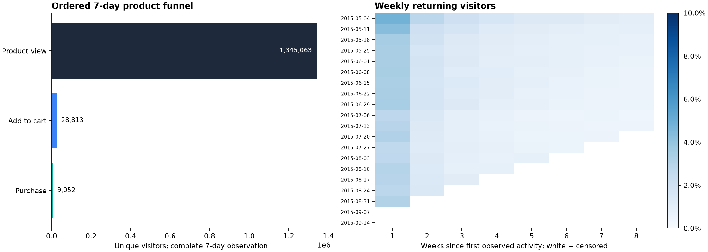

# Product Funnel Analysis

**SQL · Tableau · Python | 2.76 million real ecommerce events**

An end-to-end product analytics project using Retailrocket's public clickstream to locate conversion bottlenecks, compare early engagement signals, and measure cohort retention. SQL performs the transformations; Python orchestrates loading and exports; a packaged Tableau workbook contains the dashboard sources.



| Metric | Measured result |
|---|---:|
| Raw event records | 2,756,101 |
| Distinct events after exact deduplication | 2,755,641 |
| Observed visitors | 1,407,580 |
| Eligible unique product viewers | 1,345,063 |
| Ordered view → cart conversion | 2.14% |
| Ordered view → cart → purchase conversion | 0.67% |

The largest absolute drop-off occurs before add-to-cart. These observations motivate product-detail and cart-friction experiments; they do not establish the effect of an intervention.

## Reproduce

Python 3.13 was used for the published outputs. Run commands from this repository's root.

```bash
python3 -m venv .venv
source .venv/bin/activate
pip install -r requirements-dev.txt
python -m src.download
python -m src.analyze
python -m src.build_tableau
python -m pytest -q
```

The downloader retrieves only the approximately 94 MB events file, verifies SHA-256, and skips an existing verified file. The complete event stream is analyzed; no event-row sampling breaks user journeys. Allow several hundred MB of memory and disk for the SQLite database. SQL runs locally with Python's built-in SQLite; no database server is needed.

For your own Retailrocket-shaped data: `python -m src.analyze --input /path/to/events.csv`. Required headers are `timestamp,visitorid,event,itemid,transactionid`; timestamp is Unix **milliseconds** and transaction ID is nullable. Supported events are `view`, `addtocart`, and `transaction`.

## Tableau dashboard

Open [tableau/product_funnel.twbx](tableau/product_funnel.twbx) in Tableau Desktop or Tableau Public. It packages three aggregate CSV sources and three sheets: conversion funnel, weekly cohort retention, and early behavior versus subsequent purchase. An editable `.twb`, CSV sources, and the generator are included. No raw clickstream or database credentials are embedded.

**Validation limit:** package integrity, XML structure, sheet references, and embedded file paths are tested. Tableau is not installed in the build environment, so the workbook's rendering has not been verified in Tableau. The PNG above is a separately generated, visually reviewed Python chart. [Dashboard instructions](docs/TABLEAU.md) include manual construction and reconnection steps if your Tableau version requires them.

## Metric definitions

- **Funnel:** a visitor views an item, adds that same item to cart at/after the first view, and purchases it at/after the cart, all within seven days of that view. Same-timestamp ties qualify. Only visitor-item journeys with a complete seven-day observation window enter the funnel. Stage counts are distinct visitors with at least one eligible journey.
- **Retention:** any observed activity in calendar weeks after the visitor's first observed week. Weeks start Monday in UTC. Denominator is the original cohort size. Incomplete/future outcome weeks have null rates. The first acquisition week is partial and flagged; this is observed activity, not true first-ever acquisition.
- **Behavioral signals:** product views, distinct products viewed, and cart activity during the first 24 hours. Purchase outcome is measured after those 24 hours through day seven. Early purchasers and incompletely observed users are excluded. Signals are descriptive associations.
- **Product opportunity:** product-level funnel export includes items with at least 50 eligible viewers. Its viewer counts are unique visitor-item journeys and should not be summed to obtain sitewide unique users.

## AARRR coverage

| Framework stage | Available measurement | Limitation |
|---|---|---|
| Acquisition | First observed product-view activity | No acquisition channel or sign-up event |
| Activation | Add-to-cart proxy | No actual onboarding completion event |
| Retention | Weekly returning visitors | Right-censored; history begins mid-business lifecycle |
| Revenue | Purchase event proxy | No monetary amounts |
| Referral | Unavailable | No referral instrumentation |

There are no experiment assignments or onboarding interventions. **An 18% conversion lift and 9% retention growth cannot be claimed from this dataset.**

## Repository guide

| Path | Purpose |
|---|---|
| `sql/01_schema.sql`, `sql/02_transform.sql` | Raw schema, ordered funnel, cohort and segment SQL |
| `src/download.py`, `src/analyze.py` | Verified acquisition and reproducible pipeline |
| `src/build_tableau.py`, `tableau/` | Workbook generator and portable dashboard package |
| `data/processed/` | Aggregate dashboard inputs; SQLite database is ignored |
| `reports/` | Measured metrics, findings, and preview |
| `tests/` | Ordering, item identity, censoring, denominators, package references |

See [findings](reports/findings.md), [data provenance](docs/DATA.md), and [resume-ready bullets](docs/RESUME.md). Code is MIT; Retailrocket-derived aggregates and figures retain CC BY-NC-SA 4.0 attribution and terms.

## Continuous integration template

A ready-to-use [GitHub Actions template](docs/ci-template.yml) is included. The publishing login lacked GitHub’s `workflow` permission, so it is stored as documentation instead of an active workflow. After granting that permission, place it at `.github/workflows/ci.yml` to enable automated tests. All tests were run locally for this build.
